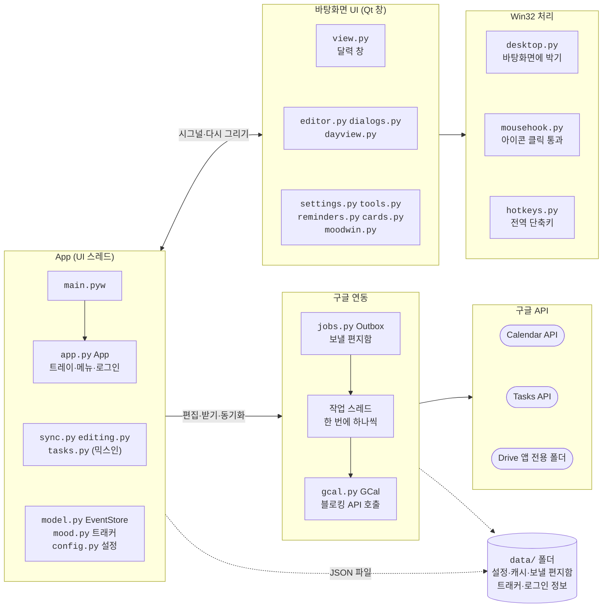

# Xetical — 구글 캘린더 바탕화면 달력

[English](README.md) | **한국어**

DesktopCal처럼 바탕화면에 박혀 있는 달력인데, 일정은 **구글 캘린더와 양방향 동기화**됩니다.

## 실행

### 실행 파일(권장, Python 필요 없음)
[Releases](https://github.com/0eti/Xetical/releases)에서 둘 중 하나를 받습니다.
서명하지 않은 개인 프로그램이라 처음에 Windows SmartScreen 경고가 뜰 수 있습니다. **추가 정보 → 실행**을 누르세요.

- **설치 파일 `Xetical-<버전>-setup.exe`**
  - 관리자 권한 없이 이 사용자에게 설치합니다(첫 화면에서 모든 사용자로 바꿀 수 있음). 시작 메뉴에 등록됩니다.
  - 설정·로그인 정보는 `%APPDATA%\Xetical`에 저장됩니다.
  - 업데이트는 새 설치 파일을 그냥 실행하면 됩니다. 제거는 Windows 설정 → 앱에서 하고, 그때 설정도 지울지 묻습니다.
- **포터블 `Xetical-<버전>-portable.zip`**
  - 원하는 곳에 압축을 풀고 `Xetical\Xetical.exe`를 실행합니다.
  - 설정·로그인 정보는 같은 폴더의 `data\`에 저장됩니다. 폴더째 옮겨도 그대로 씁니다(`portable.txt`를 지우면 `%APPDATA%\Xetical`).
  - 업데이트: 새 zip을 풀고 예전 `data\` 폴더를 새 `Xetical\` 폴더로 옮기면 됩니다.

### 소스로 실행
`Xetical.bat`을 더블클릭하세요(Python 3.10 이상 필요, 처음 한 번은 구성요소 설치로 1~2분 걸립니다).

작업 표시줄 트레이에 달력 아이콘이 생기고, 바탕화면 오른쪽 위에 달력이 나타납니다.
처음에는 아래 **구글 연동 준비**가 필요합니다.

실행 파일 직접 만들기: `.venv\Scripts\python.exe -m pip install -r requirements-build.txt` 후
`.venv\Scripts\python.exe scripts\build_exe.py` → `dist\Xetical-<버전>-portable.zip`
(Inno Setup 6이 깔려 있으면 `dist\Xetical-<버전>-setup.exe`도 만듭니다: `winget install JRSoftware.InnoSetup`)

## 사용법

화면과 조작은 DesktopCal과 같게 만들었습니다.

### 칸 편집 (DesktopCal과 같음)
- 날짜 칸을 **더블클릭**하면 칸 위에 편집창이 뜹니다. **한 줄이 일정 하나**(구글 캘린더 '하루 종일' 일정)가 됩니다.
- 다른 곳을 누르거나 `Esc`, `저장 및 닫기`를 누르면 저장됩니다.
- 편집창 아래 버튼:
  - `✓` 완료 표시(취소선). 단축키 `Ctrl+D`
  - `A` 글자색
  - `■` 칸 배경색
  - `↻` 반복 작업 추가, `⏰` 알림 추가, `⏳` 카운트다운 추가
- 편집창 안에서 우클릭하면 같은 기능이 메뉴로 나옵니다.
- 시간이 있는 일정, 반복·알림·카운트다운 일정은 편집창 위쪽 목록에 나오고, 누르면 자세한 편집 창이 열립니다.
- 반복 일정도 줄로 나옵니다(배경이 살짝 다름). 완료·글자색은 그날 것만 바뀌고, 이름을 바꾸거나 지우면 **이번 일정만 / 이번 및 이후 일정 / 모든 일정** 중에 고릅니다.

### 제목줄 버튼 (왼쪽부터)

| 버튼 | 기능 |
|---|---|
| 🏠 | 오늘로 돌아가기(다른 페이지를 볼 때만 보임) |
| 🧩 | 표시할 캘린더, 공휴일·음력·24절기 |
| 📱 | 휴대폰용 구글 캘린더 앱 QR 코드 |
| ☁ | 동기화(로그인 전에는 로그인). 마우스를 올리면 마지막 동기화 시각과 보내기 대기 수가 보입니다 |
| 👤 | 계정 센터 |
| ← → | 이전/다음 페이지(한 달씩) |
| ☰ | 추가 옵션 메뉴 |

### 그 밖의 조작
- **할 일 체크:** 칸의 `☐`를 한 번 누르면 바로 완료(`☑`)됩니다.
- **반복 할 일:** '새 할 일' 창에서 반복(매일·매주·2주마다·매월·매년)을 고르면 구글 캘린더에 하루 종일 반복 일정으로 만들어져, 휴대폰 구글 캘린더에서도 앞으로의 날짜가 보입니다. Xetical에서는 회차마다 `☐`로 보이고 누르면 그 회차만 완료됩니다(완료 표시는 Xetical에서만 보입니다). 구글 할 일(Tasks)에는 반복 기능이 없어 이렇게 만듭니다.
- **날짜 숫자 클릭:** 그날 **하루 상세 보기**(시간표)가 열립니다. 빈 시간대를 더블클릭하면 그 시각에 새 일정을 만듭니다.
- **끌어서 옮기기:** 일정을 다른 날짜 칸으로 끌어다 놓으면 날짜가 바뀝니다(시각은 그대로).
- **여러 날 일정:** 칸을 가로지르는 막대로 보입니다.
- **실행 취소:** 달력을 한 번 누른 뒤 `Ctrl+Z`. 칸 편집, 옮기기, 붙여넣기, 삭제, 할 일 체크, 칸 배경색을 되돌립니다(최근 50개).
- **복사·붙여넣기:** 일정을 눌러 선택한 뒤 `Ctrl+C`(잘라내기 `Ctrl+X`), 다른 칸을 누르고 `Ctrl+V`. 우클릭 메뉴로도 할 수 있습니다. `Delete`는 삭제입니다.
- **우클릭:** 일정 위에서 누르면 편집, 복사, 잘라내기, 삭제, 초대 응답과 '이 날짜' 하위 메뉴가 나옵니다. 빈 칸에서 누르면 그날 편집, 하루 상세 보기, 새 일정, 새 할 일, 붙여넣기, 칸 배경색, 실행 취소, 설정이 나옵니다. 나머지는 ☰ 메뉴에 있습니다.
- **초대받은 일정:** `✉`(응답 필요)나 `?`(미정)가 붙어 기울어진 글씨로 보입니다. 일정 창이나 우클릭에서 참석/미정/거절로 응답합니다(주최자에게 알림이 갑니다).
- **인터넷이 끊겼을 때:** 고친 내용은 `data\outbox.json`에 보관했다가 연결되면 자동으로 보냅니다. 위쪽에 "오프라인 — 저장 대기 N개"가 보입니다.
- **마우스 휠:** 내용이 넘치는 칸 안에서 스크롤. 설정을 켜면 주 이동도 됩니다.
- **단축키:** `Ctrl+Alt+H` 달력 숨기기/보이기, `Ctrl+Alt+J` 예약된 작업 숨기기/보이기(설정에서 켜기)
- **알림:** 정한 시각에 화면 오른쪽 아래에 알림 창이 뜹니다. 휴대폰 구글 캘린더에도 알림이 갑니다.
- **카운트다운:** 달력 아래 바, 또는 바탕화면 카드로 "N일 남음"을 보여 줍니다. 카드는 끌어서 옮길 수 있습니다.
- **아침 요약:** 설정 → 할 일 · 알림에서 켜면, 매일 정한 시각에 오늘 일정과 할 일을 알려 줍니다.
- **트래커(무드 트래커 등):** 설정 → 트래커에서 켜면 달력 아래에 올해 365일이 칸으로 나옵니다.
  - **위치**는 달력 아래·위·왼쪽·오른쪽(왼쪽·오른쪽이면 칸을 세로로 세움) 중에서 고르거나, **따로 떼어 바탕화면에** 둘 수 있습니다. 따로 떼면 달력과 같이 ☰ → **위치 및 크기**에서 끌어 아무 데나 옮기고, 오른쪽 아래 모서리를 끌어 크기를 바꿉니다(✓ 완료를 누르면 저장).
  - 오늘이나 지난 날 칸을 **더블클릭**(또는 오른쪽 클릭)하면 색을 고릅니다(기분, 운동했는지 등).
  - 트래커를 여러 개 만들 수 있고(처음에는 '기분', '운동'), 칸 위의 이름을 눌러 바꿉니다.
  - 모양은 주 단위(7줄 × 53주)와 월 단위(12줄 × 31일) 중에서 고릅니다. 주 단위는 1월 1일을 왼쪽 위부터 차례로 놓거나, 한 줄이 한 요일이 되게 놓을 수 있습니다.
  - 이 PC(`data\moods.json`)에 저장하고, 설정 백업에도 함께 들어갑니다.
  - 설정에서 **구글 드라이브에 동기화**를 켜면 같은 구글 계정을 쓰는 PC끼리 맞춰집니다(아래 '구글 연동 준비' 참고).
- **모니터 변경:** 모니터를 빼거나 해상도·배율이 바뀌면 달력과 카드를 화면 안으로 다시 맞춥니다.

### ☰ 메뉴
- 날짜로 이동(달력 위쪽에서 월·연도도 고를 수 있음)
- 실행 취소, 내용 검색
- 예약된 작업 숨기기, 캘린더 숨기기, 위치 및 크기
- 내보내기(텍스트·Excel CSV)
- 설정, 종료
- 오늘로·이전/다음 페이지·동기화·계정은 제목줄 버튼으로, 최대 행·자동 동기화는 설정 창에서 바꿉니다.
- 설정 창:
  - 캘린더 / 셀 / 글꼴 및 색상 / 고급 탭: DesktopCal 설정과 같은 항목
  - 할 일 · 알림 / 계정 / 정보 탭: Xetical에만 있는 항목
  - **테마(색 조합)**, **설정 백업·복원**도 여기 있습니다.

### DesktopCal과 다른 점
- 일정은 구글 캘린더에 저장됩니다. 칸 배경색과 설정만 이 PC(`data` 폴더)에 저장됩니다.
- DesktopCal의 VIP 기능(서브계정, 기록 보기 등)과 스티커 메모, 시간표, 벽지 스킨, AI 플랫폼은 없습니다.
- 달력 아래에 있는 바탕화면 아이콘은 기본적으로 클릭할 수 없습니다.
  - 설정 → 고급 → **바탕화면 아이콘 클릭 통과**를 켜면 아이콘 위는 아이콘으로, 빈 곳은 달력으로 동작합니다.
  - DesktopCal처럼 탐색기에 코드를 넣지 않고, 마우스 위치에 아이콘이 있는지 탐색기에 물어보는 방식입니다.
- 앞으로 만들 기능(실행 파일, 빠른 입력, 일정 종류 아이콘)의 계획은 `docs/plans.md`에 있습니다.

## 구글 연동 준비 (처음 한 번, 약 10분)

구글은 개인이 만든 프로그램이 캘린더에 접근하려면 **본인 소유의 OAuth 클라이언트**를 쓰도록 합니다.
무료이고, 결제 정보도 필요 없습니다.

1. <https://console.cloud.google.com> 접속 → 위쪽 프로젝트 선택 → **새 프로젝트** → 이름 `Xetical` → 만들기
2. 왼쪽 메뉴 **API 및 서비스 → 라이브러리** → `Google Calendar API` 검색 → **사용**
3. 왼쪽 메뉴 **Google 인증 플랫폼(OAuth 동의 화면)** → **시작하기**
   - 앱 이름: `Xetical`, 사용자 지원 이메일: 본인 Gmail
   - 대상: **외부(External)**
   - 연락처 이메일: 본인 Gmail → 동의 후 **만들기**
4. **대상(Audience)** 메뉴 → **테스트 사용자 → + Add users** → 본인 Gmail 추가 → 저장 (**필수**)
   - 빠뜨리면 로그인할 때 구글이 접근을 거부합니다.
   - 테스트 상태에서는 **7일마다 로그인이 풀립니다.** 달력 위쪽의 "로그인이 만료되었습니다 — 여기를 클릭"을 누르면 다시 로그인됩니다.
   - (선택) 7일 만료를 없애려면 같은 화면의 **앱 게시**로 프로덕션 상태로 바꿔야 합니다.
     게시 버튼이 꺼져 있으면 브랜딩 화면에 홈페이지·개인정보처리방침 링크와 승인된 도메인을 넣어야 합니다
     (예: GitHub Pages). 앱 로고는 올리지 마세요. 로고가 있으면 구글 심사를 받아야 게시됩니다.
5. **클라이언트(Clients)** 메뉴 → **클라이언트 만들기**
   - 애플리케이션 유형: **데스크톱 앱**, 이름: `Xetical` → 만들기
   - 나오는 창에서 **JSON 다운로드**
6. Xetical 메뉴 → `client_secret.json 불러오기…` → 방금 받은 파일 선택
7. 브라우저가 열리면 본인 구글 계정으로 로그인
   - "Google에서 확인하지 않은 앱" 경고가 나오면 **고급 → Xetical(으)로 이동(안전하지 않음)** 을 누르면 됩니다.
     (본인이 만든 앱이라 그렇습니다)
   - 캘린더 권한 체크박스를 모두 허용

끝나면 달력에 구글 일정이 나타납니다.

**(선택) 트래커를 여러 PC에서 맞추려면**
1. 위 2번처럼 **API 및 서비스 → 라이브러리** → `Google Drive API` 검색 → **사용**
2. 설정 → 트래커 → **구글 드라이브에 동기화** 켜기
3. 달력 위쪽의 "트래커를 동기화하려면 다시 로그인 — 여기를 클릭"을 눌러 다시 로그인하고, 드라이브 권한도 허용
   - 드라이브의 **앱 전용 숨은 폴더**만 씁니다. 드라이브 목록에는 보이지 않고, 다른 파일에는 접근하지 않습니다.

## 참고

- 공휴일은 구글의 '대한민국의 휴일' 캘린더에서 가져옵니다.
- 반복 일정을 수정·삭제하면 **그 날짜 하나만** 바뀝니다. 반복 전체는 구글 캘린더에서 수정하세요.
- 인터넷이 끊겨도 마지막으로 받은 일정이 그대로 보입니다.
- 설정, 로그인 정보, 일정 캐시는 모두 `data` 폴더에 있습니다. 로그인 정보(`token.json`)는 다른 사람과 공유하지 마세요.
- 오류 기록: `data\xetical.log`
- 폴더를 옮겼다면 설정에서 `Windows 시작 시 자동 실행`을 한 번 껐다 켜 주세요. 경로가 갱신됩니다.

## 구조

- `App`(`app.py`)은 Qt UI 스레드에서 돌며 모든 부분을 엮습니다. `sync.py`, `editing.py`, `tasks.py`는 `App`이 상속하는 믹스인입니다.
- 구글에 쓰는 변경은 모두 보낼 편지함(`jobs.py`)을 거칩니다. 화면에 먼저 반영하고(새 항목은 임시 id `tmp-N`), `data/outbox.json`에 저장한 뒤 순서대로 보내며, 오프라인이면 다시 시도합니다.
- `gcal.py`의 호출은 블로킹이라 백그라운드 작업 스레드 하나에서만 실행하고(브라우저 로그인은 따로 된 스레드), 결과는 Qt 시그널로 UI 스레드에 돌려줍니다.
- 반복 할 일은 구글 캘린더의 하루 종일 반복 일정입니다(`todos.py`). Tasks API에 반복이 없기 때문입니다. 트래커는 `data/moods.json`에 두고, 켜면 드라이브의 앱 전용 숨은 폴더에도 올립니다.
