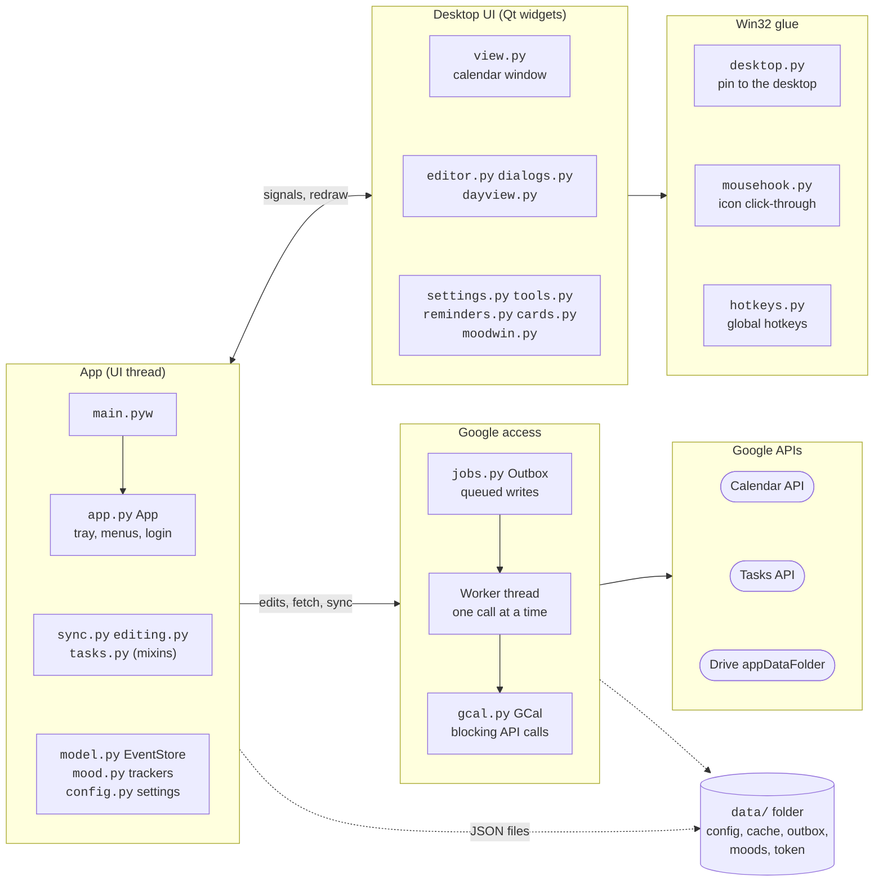

# Xetical — Google Calendar desktop calendar

**English** | [한국어](README.ko.md)

A calendar embedded in your desktop like DesktopCal, but your events are **synced both ways with Google Calendar**.

The app's interface is in Korean. Where a button or menu shows Korean text, the Korean label is given in backticks so you can find it.

## Running

### Executable (recommended, no Python needed)
Download one of the two from [Releases](https://github.com/0eti/Xetical/releases).
This is an unsigned personal program, so Windows SmartScreen may show a warning the first time. Click **More info → Run anyway**.

- **Installer `Xetical-<version>-setup.exe`**
  - Installs for the current user without admin rights (you can switch to all users on the first screen). It is added to the Start menu.
  - Settings and login data are stored in `%APPDATA%\Xetical`.
  - To update, just run the new installer. Uninstall from Windows Settings → Apps; it asks whether to delete your settings too.
- **Portable `Xetical-<version>-portable.zip`**
  - Extract it anywhere and run `Xetical\Xetical.exe`.
  - Settings and login data are stored in `data\` in the same folder. You can move the whole folder and keep using it (delete `portable.txt` to use `%APPDATA%\Xetical` instead).
  - To update: extract the new zip and move your old `data\` folder into the new `Xetical\` folder.

### Running from source
Double-click `Xetical.bat` (requires Python 3.10 or later; the first run takes 1–2 minutes to install dependencies).

A calendar icon appears in the taskbar tray, and the calendar shows up at the top right of the desktop.
The first time, you need to complete [Google setup](#google-setup-one-time-about-10-minutes) below.

Building the executable yourself: `.venv\Scripts\python.exe -m pip install -r requirements-build.txt`, then
`.venv\Scripts\python.exe scripts\build_exe.py` → `dist\Xetical-<version>-portable.zip`
(if Inno Setup 6 is installed, it also builds `dist\Xetical-<version>-setup.exe`: `winget install JRSoftware.InnoSetup`)

## Usage

The screen layout and controls are made to match DesktopCal.

### Cell editing (same as DesktopCal)
- **Double-click** a date cell to open an editor on top of it. **Each line becomes one event** (a Google Calendar "all day" event).
- Clicking elsewhere, pressing `Esc`, or clicking `저장 및 닫기` (Save and close) saves it.
- Buttons below the editor:
  - `✓` mark as done (strikethrough). Shortcut `Ctrl+D`
  - `A` text color
  - `■` cell background color
  - `↻` add a repeating task, `⏰` add a reminder, `⏳` add a countdown
- Right-clicking inside the editor shows the same functions as a menu.
- Timed events and events with repeat, reminder, or countdown appear in a list at the top of the editor; click one to open the detailed edit window.
- Recurring events also appear as lines (with a slightly different background). Done and text color change only that day's occurrence; renaming or deleting asks you to choose **This event only / This and following events / All events** (`이번 일정만` / `이번 및 이후 일정` / `모든 일정`).

### Title bar buttons (from left)

| Button | Function |
|---|---|
| 🏠 | Back to today (shown only when viewing another page) |
| 🧩 | Calendars to show; holidays, lunar calendar, 24 solar terms |
| 📱 | QR code for the Google Calendar mobile app |
| ☁ | Sync (log in, if not logged in yet). Hover to see the last sync time and the number of changes waiting to be sent |
| 👤 | Account center |
| ← → | Previous/next page (one month at a time) |
| ☰ | More options menu |

### Other controls
- **Checking off to-dos:** Click a `☐` in a cell once and it is completed (`☑`) right away.
- **Repeating to-dos:** In the "New to-do" (`새 할 일`) window, choose a repeat (daily, weekly, every 2 weeks, monthly, yearly) and it is created as an all-day recurring event in Google Calendar, so future dates are visible in Google Calendar on your phone as well. In Xetical each occurrence appears as `☐`, and clicking it completes only that occurrence (the done mark is visible only in Xetical). This is how it works because Google Tasks has no repeat feature.
- **Clicking a date number:** Opens the **day detail view** (`하루 상세 보기`, a timetable) for that day. Double-click an empty time slot to create a new event at that time.
- **Drag to move:** Drag an event onto another date cell to change its date (the time stays the same).
- **Multi-day events:** Shown as bars spanning cells.
- **Undo:** Click the calendar once, then `Ctrl+Z`. Undoes cell edits, moves, pastes, deletions, to-do check-offs, and cell background colors (the last 50).
- **Copy and paste:** Click an event to select it, `Ctrl+C` (cut: `Ctrl+X`), click another cell, then `Ctrl+V`. You can also do this from the right-click menu. `Delete` deletes.
- **Right-click:** On an event: edit, copy, cut, delete, reply to invitation, and a "This date" (`이 날짜`) submenu. On an empty cell: edit that day, day detail view, new event, new to-do, paste, cell background color, undo, and settings. Everything else is in the ☰ menu.
- **Invitations:** Shown in italics with `✉` (response needed) or `?` (maybe). Reply Yes/Maybe/No from the event window or the right-click menu (the organizer is notified).
- **When you are offline:** Your changes are kept in `data\outbox.json` and sent automatically when you reconnect. "Offline — N changes waiting to be saved" (`오프라인 — … 저장 대기 …`) is shown at the top.
- **Mouse wheel:** Scrolls inside a cell whose content overflows. If enabled in settings, it also moves by weeks.
- **Shortcuts:** `Ctrl+Alt+H` hide/show the calendar, `Ctrl+Alt+J` hide/show scheduled tasks (enable in settings)
- **Reminders:** At the set time, a reminder window pops up at the bottom right of the screen. Google Calendar on your phone also gets the reminder.
- **Countdowns:** Show "N days left" in a bar below the calendar or on a desktop card. Cards can be dragged around.
- **Morning summary:** If enabled in Settings → To-dos · Reminders, it tells you today's events and to-dos at a set time every day.
- **Trackers (mood tracker, etc.):** If enabled in Settings → Trackers (`트래커`), this year's 365 days appear as cells below the calendar.
  - For the **position**, choose below, above, left of, or right of the calendar (left or right stands the cells up vertically), or **detach it onto the desktop**. When detached, move it anywhere by dragging in ☰ → **Position and size** (`위치 및 크기`), just like the calendar, and resize it by dragging the bottom-right corner (click ✓ Done (`✓ 완료`) to save).
  - **Double-click** (or right-click) a cell for today or a past day to pick a color (your mood, whether you exercised, etc.).
  - You can create several trackers (at first there are "Mood" (`기분`) and "Exercise" (`운동`)); click the name above the cells to switch.
  - Choose the shape: weekly (7 rows × 53 weeks) or monthly (12 rows × 31 days). In weekly mode, January 1 can start at the top left and continue in order, or each row can be one weekday.
  - Saved on this PC (`data\moods.json`) and included in the settings backup.
  - Turn on **Sync to Google Drive** (`구글 드라이브에 동기화`) in settings to keep PCs using the same Google account in step (see [Google setup](#google-setup-one-time-about-10-minutes) below).
- **Monitor changes:** If a monitor is unplugged or the resolution or scaling changes, the calendar and cards are moved back onto the screen.

### ☰ menu
- Go to date (you can also pick the month and year at the top of the calendar)
- Undo, Search content
- Hide scheduled tasks, Hide calendar, Position and size
- Export (text, Excel CSV)
- Settings, Exit
- Today, previous/next page, sync, and account are on the title bar buttons; max rows and auto sync are changed in the settings window.
- Settings window:
  - Calendar / Cell / Font and color / Advanced tabs (`캘린더` / `셀` / `글꼴 및 색상` / `고급`): the same items as DesktopCal's settings
  - To-dos · Reminders / Account / About tabs (`할 일 · 알림` / `계정` / `정보`): items only in Xetical
  - **Themes (color schemes)** and **settings backup and restore** are here too.

### Differences from DesktopCal
- Events are stored in Google Calendar. Only cell background colors and settings are stored on this PC (the `data` folder).
- DesktopCal's VIP features (sub-accounts, history, etc.), sticky notes, timetable, wallpaper skins, and AI platform are not included.
- Desktop icons under the calendar cannot be clicked by default.
  - Turn on Settings → Advanced → **Click through to desktop icons** (`바탕화면 아이콘 클릭 통과`) so that clicks on an icon go to the icon and clicks on empty space go to the calendar.
  - Unlike DesktopCal, it does not inject code into Explorer; it asks Explorer whether there is an icon under the mouse.
- Plans for future features (executable, quick entry, event type icons) are in `docs/plans.md`.

## Google setup (one time, about 10 minutes)

Google requires a personally made program to use **your own OAuth client** to access your calendar.
It is free and needs no payment information.

1. Go to <https://console.cloud.google.com> → project picker at the top → **New Project** → name `Xetical` → Create
2. Left menu **APIs & Services → Library** → search for `Google Calendar API` → **Enable**
3. Left menu **Google Auth Platform (OAuth consent screen)** → **Get started**
   - App name: `Xetical`, User support email: your Gmail
   - Audience: **External**
   - Contact email: your Gmail → agree, then **Create**
4. **Audience** menu → **Test users → + Add users** → add your Gmail → Save (**required**)
   - If you skip this, Google denies access when you log in.
   - While in testing, **your login expires every 7 days.** Click "Login has expired — click here" (`로그인이 만료되었습니다 — 여기를 클릭`) at the top of the calendar to log in again.
   - (Optional) To remove the 7-day expiry, switch to production with **Publish app** on the same screen.
     If the publish button is disabled, add homepage and privacy policy links and an authorized domain on the Branding screen
     (e.g. GitHub Pages). Do not upload an app logo. With a logo, the app has to pass Google's review before it can be published.
5. **Clients** menu → **Create client**
   - Application type: **Desktop app**, Name: `Xetical` → Create
   - In the dialog that appears, click **Download JSON**
6. Xetical menu → `client_secret.json 불러오기…` (Load client_secret.json…) → choose the file you just downloaded
7. When the browser opens, log in with your Google account
   - If you see a "Google hasn't verified this app" warning, click **Advanced → Go to Xetical (unsafe)**.
     (It says this because you made the app yourself.)
   - Allow all the calendar permission checkboxes

When you are done, your Google events appear on the calendar.

**(Optional) To keep trackers in sync across several PCs**
1. As in step 2 above, **APIs & Services → Library** → search for `Google Drive API` → **Enable**
2. Settings → Trackers → turn on **Sync to Google Drive**
3. Click "Log in again to sync trackers — click here" (`트래커를 동기화하려면 다시 로그인 — 여기를 클릭`) at the top of the calendar, log in again, and also allow the Drive permission
   - Only Drive's **hidden app-specific folder** is used. It does not appear in your Drive file list, and no other files are accessed.

## Notes

- Holidays come from Google's "Holidays in South Korea" calendar.
- If you go offline, the last events received are still shown.
- Settings, login data, and the event cache are all in the `data` folder. Do not share your login data (`token.json`) with anyone.
- Error log: `data\xetical.log`
- If you moved the folder, turn `Windows 시작 시 자동 실행` (Run at Windows startup) off and on once in settings. This updates the path.

## Structure

- `App` (`app.py`) runs on the Qt UI thread and wires everything together; `sync.py`, `editing.py`, and `tasks.py` are mixins that `App` inherits.
- Every write to Google goes through the Outbox (`jobs.py`): the change shows on screen right away (new items get temporary `tmp-N` ids), is saved to `data/outbox.json`, and is sent in order, with retries while offline.
- `gcal.py` makes blocking calls, so they run only on the single background Worker thread (browser login uses a separate thread); results come back to the UI thread through a Qt signal.
- Repeating to-dos are all-day recurring events in Google Calendar (`todos.py`), because the Tasks API has no repeat. Trackers live in `data/moods.json` and, optionally, in Drive's hidden app folder.
